# GBA Link

Play Game Boy Advance, Game Boy and Game Boy Color games inside Minecraft, and link up with friends using a Link Cable (GBA games).
A Fabric mod for **Minecraft 26.3**, built on the [mGBA](https://mgba.io/) emulator core.

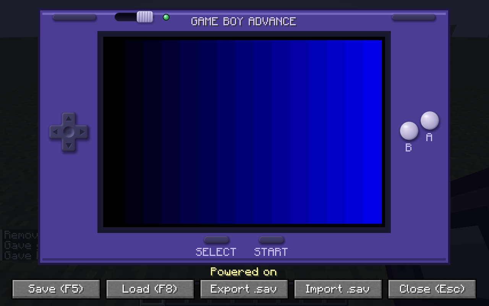

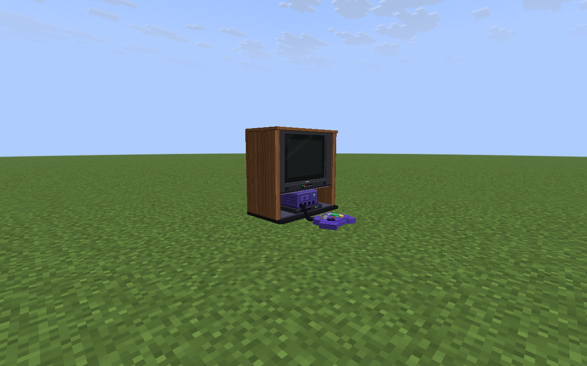

## Screenshots

Real captures from the dev client with real cartridges (not included in this repo).

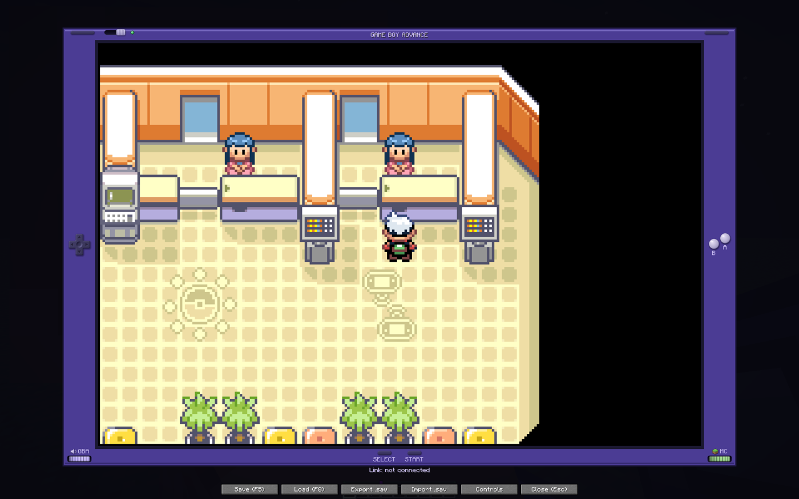

*Pokemon Emerald running on the GBA screen (after Continue, standing in a Pokemon Center).*

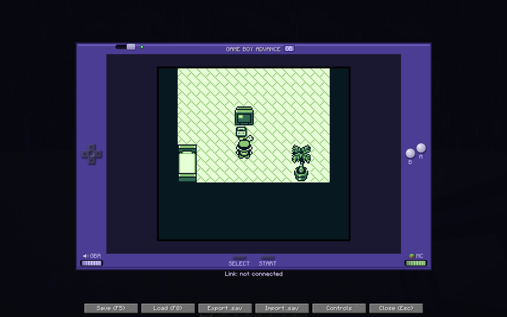

*Pokemon Red (Game Boy) on the same screen: 10:9 picture, green LCD palette, "GB" tag. This is the start of a new game (the player's bedroom), not a late-game save.*

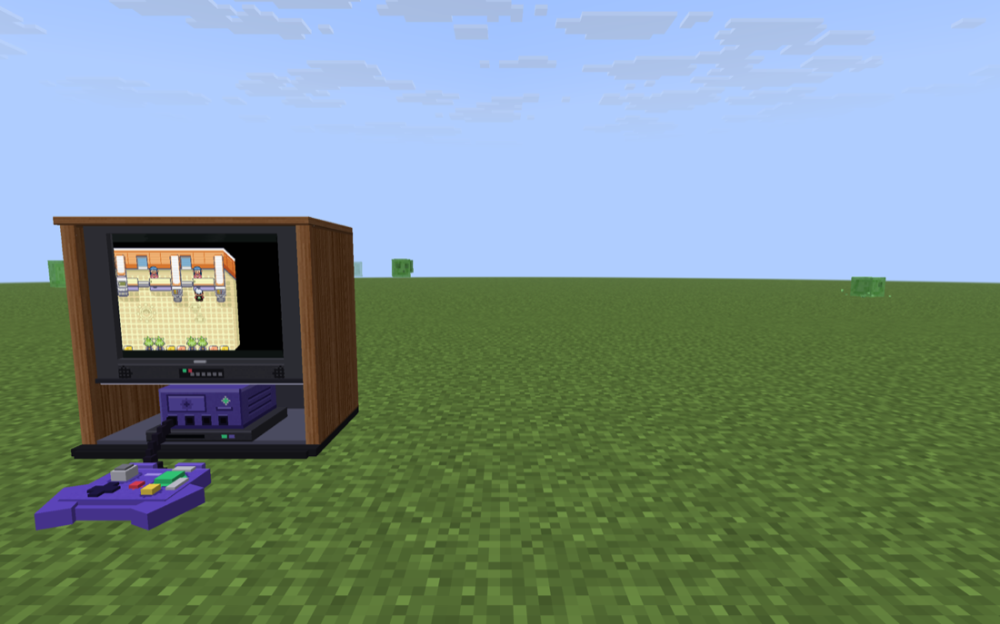

*Emerald on the CRT TV, seen by a second player standing nearby (the viewer needs no ROM).*

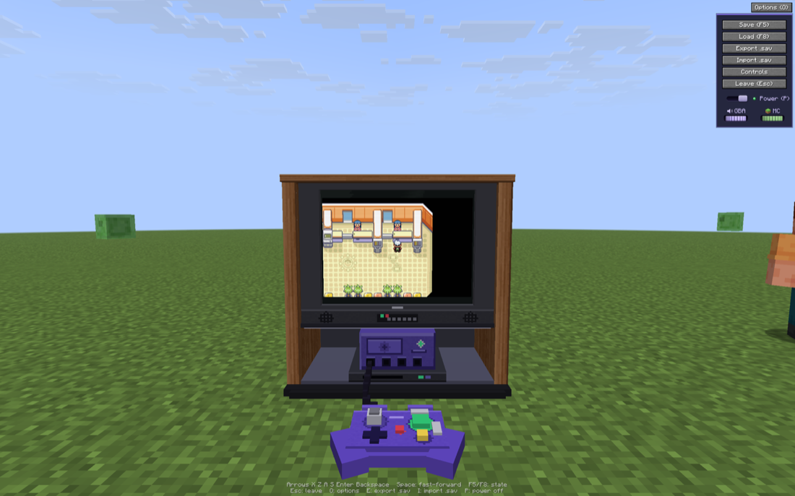

*The CRT TV's Options panel (top right) with the new Controls button, as seen by the player.*

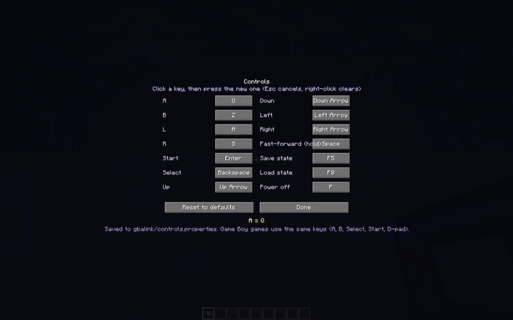

*The Controls screen (key map). Everything is at its default except **A**, which was rebound to `Q` in the capture to show a change being saved.*

Two players linked with a cable (netplay, both running Pokemon Emerald with their own save) in the Cable Club:

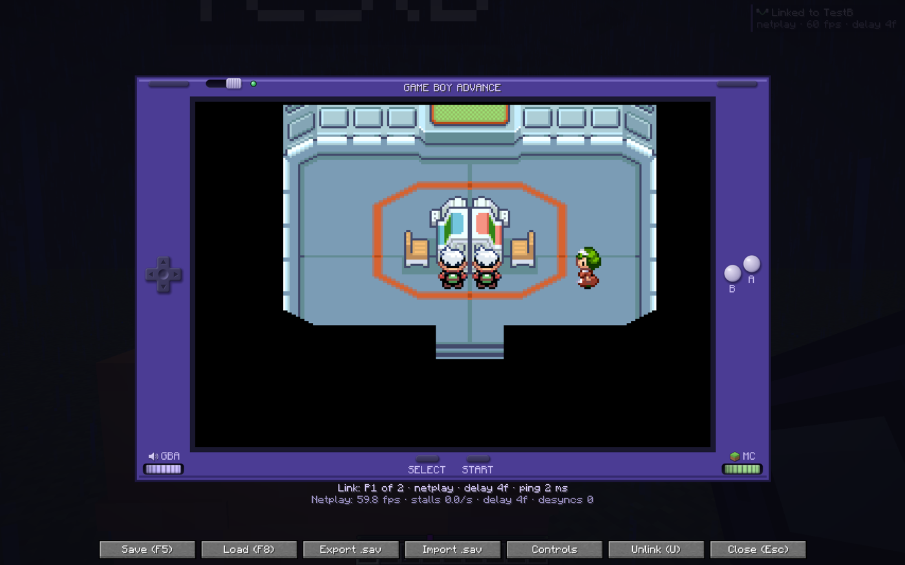

*Both players' characters at the Trade Center table (one client's GBA screen; the status line shows "Link: P1 of 2 - netplay").*

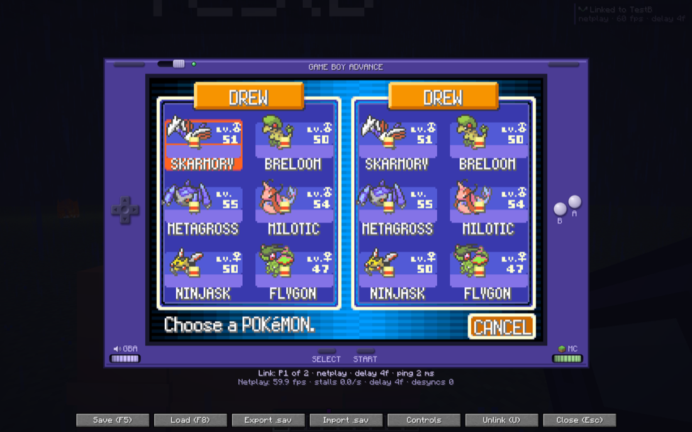

*The Cable Club trade screen, with both players' parties shown ("Choose a POKeMON"). Both save files happen to use the same trainer name.*

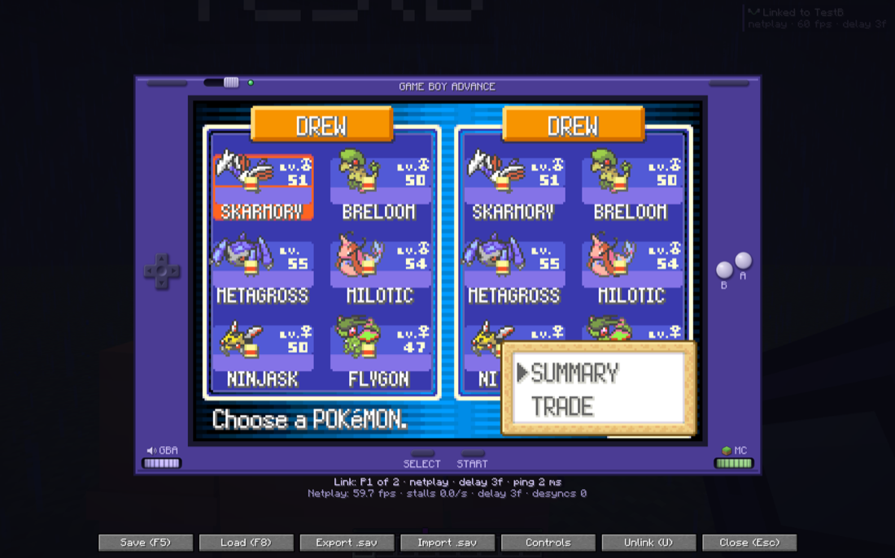

*One player opening the Summary / Trade menu for a party member. The actual exchange of Pokemon was not completed in this capture session.*

## What it is

* **A playable GBA in your inventory.** Craft a Game Boy Advance, burn a game onto a Blank Game Pak,
  insert it, and play in a GBA-shaped screen with sound. The same console and the same pak also play
  **Game Boy (`.gb`) and Game Boy Color (`.gbc`) games** (see [Supported systems](#supported-systems)).
* **A CRT TV.** Craft a big wooden TV cabinet with a console and controller built in, place it in the world, and play
  on the TV itself while friends nearby watch the picture and hear the sound (see [CRT TV](#crt-tv)).
* **Real link cable support.** Use a Link Cable on a friend and play multiplayer GBA games together
  (2 to 4 players), for example trading or battling.
* **Saves live on the server**, inside each Game Pak, so a pak keeps its progress when you hand it to a
  friend or log in from another computer. Closing the screen suspends your game exactly where it was; save states
  (F5 / F8), fast-forward (Space or Tab) and `.sav` export / import are built in.
* **Easy to host.** One mod jar (plus Fabric API) on the server. Recipes are built into the mod, no
  datapack needed. Players without the mod can still join and see the items; they just can't play.
* **Bring your own ROMs.** No games, BIOS files or downloads are included or provided by this project.
  You must supply ROM files you legally own. (mGBA's built-in replacement BIOS is used, so you don't
  need a BIOS file either.)

Works on Windows (x64), macOS (Intel and Apple Silicon) and Linux (x64).

## Supported systems

| System | ROM files in `gbalink/roms/` | Notes |
| --- | --- | --- |
| Game Boy Advance | `.gba` | everything the mod did before, including the link cable and netplay |
| Game Boy Color | `.gbc` (or a `.gb` with the colour flag) | mGBA's normal colours, **no colour correction** is applied |
| Game Boy (monochrome) | `.gb` | drawn with a classic **green LCD palette** (`#E0F8D0 #88C070 #346856 #081820`) instead of plain grey |

The system is read from the ROM's header, not from the file name: a Game Boy ROM needs the Nintendo logo and a valid header
checksum and may be at most 8 MiB; a GBA ROM needs its fixed header byte and may be at most 32 MiB. Files that fail these checks
are listed with the reason in the burn screen. Super Game Boy borders are off (Super Game Boy games run as plain Game Boy
games, 160x144). **Link cable support for Game Boy games is coming later**: with a Game Boy or Game Boy Color game open
the status says "Link cable for Game Boy games isn't supported yet" and you behave as unlinked (other players keep linking
among themselves). Battery saves (including the real-time clock of Pokémon Gold / Silver / Crystal cartridges), save states,
suspend / power switch, `.sav` export / import, the CRT TV and its viewers all work for Game Boy games.

## Which file do I need?

Everything is on the [Releases](../../releases) page.

| Release file | What it is | Who needs it |
| --- | --- | --- |
| `gbalink-x.y.z.jar` | The mod itself (client and server in one jar, emulator included) | **The server and every player.** Together with [Fabric API](https://modrinth.com/mod/fabric-api) |
| `gbalink-x.y.z.mrpack` | A one-click Prism / Modrinth App instance that installs Minecraft 26.3, Fabric, Fabric API **and** the mod | Players only, optional convenience. Not for servers |
| `gbalink-resourcepack-x.y.z.zip` | Item textures and models | **Optional, server owners only**: lets players *without* the mod see the textures. Players with the mod do not need it |
| `SHA256SUMS.txt` | Checksums of the other files | Optional: to verify your download |

**Everyone must run the same mod version as the server.** If the versions differ, the GBA tells you to
update the mod instead of failing.

## Server install

Requires Java 25 and a [Fabric](https://fabricmc.net/use/server/) server for Minecraft 26.3
(loader 0.19.5 or newer).

1. Set up a Fabric server for 26.3 and start it once.
2. Put these two files into the server's `mods/` folder:
   * [Fabric API](https://modrinth.com/mod/fabric-api) `0.162.0+26.3` (or newer for 26.3)
   * `gbalink-<version>.jar`
3. Restart the server. That's all: the crafting recipes ship inside the jar. Tell your players to install the
   **same version** of the mod ([Client install](#client-install)).

**Optional: item textures for vanilla players.** Players who have the mod see the custom item textures
automatically. To give players *without* the mod nicer textures too, host
`gbalink-resourcepack-<version>.zip` at a direct download URL and set it as the server resource pack in
`server.properties`:

```properties
resource-pack=https://example.com/gbalink-resourcepack-0.4.0.zip
resource-pack-sha1=<sha1 of the zip>
```

Get the checksum with `shasum -a 1 gbalink-resourcepack-0.4.0.zip` (macOS/Linux) or
`certutil -hashfile gbalink-resourcepack-0.4.0.zip SHA1` (Windows). Without the resource pack, vanilla
players simply see the plain base items (amethyst shard, iron nugget, copper ingot) with their custom names.

**Vanilla clients can still join.** The mod registers no blocks, items or other registry entries; the
items are ordinary vanilla items carrying custom data, and everything else uses optional custom packets.
Players without the mod can pick up and carry the items, and are told to install the mod when they try to
use one.

**Admin commands**

| Command | Who | What |
| --- | --- | --- |
| `/gba give <gba\|blank_pak\|cable\|crt> [player]` | operators | Hand out items |
| `/gba info` | everyone | Shows whether your client has the mod and your link status |
| `/gba unlink` | everyone | Removes your link cable connection |

**Server files.** Saves are stored in the world folder: `world/gbalink/saves/<pak id>.sav` (back them up with
your world). When a player imports a save, the previous one is kept next to it as `<pak id>.sav.bak1`,
`.bak2`, `.bak3` (newest first). Settings live in `config/gbalink.properties` (see [CRT TV](#crt-tv)).

## Client install

Players need the mod on their own computer to actually play. The game must be Minecraft **26.3** with
Fabric Loader **0.19.5** or newer, and the mod must be the same version as the server's.

### Option A: official Minecraft Launcher

Download these from [Modrinth](https://modrinth.com/mod/fabric-api/versions) and the [Releases](../../releases)
page:

* **Fabric API** `0.162.0+26.3` (a `.jar`)
* **`gbalink-<version>.jar`**

Then:

1. Download the [Fabric installer](https://fabricmc.net/use/installer/), run it, pick **Minecraft 26.3**
   and **loader 0.19.5**, and click Install. This creates a "fabric-loader-26.3" profile.
2. Put both jars into your `mods` folder (create it if it doesn't exist):

   | OS | Folder |
   | --- | --- |
   | Windows | `%APPDATA%\.minecraft\mods` |
   | macOS | `~/Library/Application Support/minecraft/mods` |
   | Linux | `~/.minecraft/mods` |

3. Start the launcher, choose the **Fabric** profile, and play. Java 25 is required (the launcher downloads a
   suitable Java automatically).

### Option B: Prism Launcher or the Modrinth App

**Easy path.** Download **`gbalink-<version>.mrpack`** from the [Releases](../../releases) page and import it
(Prism: *Add Instance, Import*, drop the file in; Modrinth App: *Add instance, From file*). It installs
Minecraft 26.3, Fabric Loader, Fabric API and GBA Link in one go. Nothing else to download.

**Manual path.** Download **Fabric API** `0.162.0+26.3` and **`gbalink-<version>.jar`**, then:

1. Create a new instance for Minecraft **26.3** and choose **Fabric** as the loader.
2. Open *Edit instance, Mods*, click *Add file* (or open the mods folder), and add both jars.

(In Prism you can also let it download Fabric API for you under *Download mods*.)

## Folders

The mod creates all of these **automatically the first time you launch Minecraft with it installed**, inside the
`gbalink/` folder of your game directory:

| Launcher | Game directory |
| --- | --- |
| Official launcher, Windows | `%APPDATA%\.minecraft` |
| Official launcher, macOS | `~/Library/Application Support/minecraft` |
| Official launcher, Linux | `~/.minecraft` |
| Prism Launcher | right-click the instance, *Folder*, then open `minecraft/` (older instances: `.minecraft/`) |
| Modrinth App | the instance's folder (*Open folder* on the instance page) |

| Folder in `gbalink/` | What goes in it |
| --- | --- |
| `roms/` | **Put your `.gba`, `.gb` and `.gbc` games here** (a `README.txt` explains it) |
| `imports/` | **Put `.sav` files here** to import them into a cartridge |
| `exports/` | Saves written by *Export .sav*, and the automatic backup made before every import |
| `saves/` | Automatic local copy of each pak's last uploaded save |
| `states/` | `F5` save states, one per pak |
| `suspend/` | Suspended games, one per pak |
| `natives/` | The emulator library, unpacked from the jar (nothing to do) |
| `link.log` | Link cable statistics, written only while a link cable is in use |

**Quick way there:** in the burn screen, **Open ROMs folder** opens `roms/`; in the import screen,
**Open imports folder** opens `imports/`.

## Adding games

Copy your own `.gba`, `.gb` or `.gbc` files into `gbalink/roms/` (see [Folders](#folders)). The burn screen rescans the folder every time you open it, so there is no need to restart
Minecraft.

Games are matched by **SHA-1 of the ROM file**. When a Game Pak is burned, it remembers the checksum of
that ROM. Everyone who wants to play that pak must have the *exact same ROM file* (same dump, same
region, same version) in their folder. If the file doesn't match, the GBA tells you which game it is
missing. Subfolders (one level deep) are scanned too.

## How to play

**Crafting** (shaped recipes, items are placed as shown):

| Item | Recipe |
| --- | --- |
| Game Boy Advance | `A G A` / `I R I` |
| Blank Game Pak | `N R N` / `N I N` |
| Link Cable | `C A C` / `_ S _` |
| CRT TV | `I I I` / `C T C` / `A R A` |

A = amethyst shard, G = glass pane, I = iron ingot, R = redstone, N = iron nugget, C = copper ingot,
S = string, T = tinted glass, `_` = empty. (Operators can also use `/gba give`.)

**Burn a game.** Hold a Blank Game Pak and press **G** (rebindable under Controls, "GBA Link") or
right-click. Pick one of your ROMs from the list; the pak is now that game. Each burned pak has its own
save file on the server.

**Insert / eject.** Hold the GBA in your main hand and a Game Pak in your **off hand**, then
**sneak + right-click** to insert it. To eject, sneak + right-click with an empty off hand; the pak lands
back in your off hand.

**Play.** Right-click with the GBA (with a pak inserted) to open the console screen. Game Boy and Game Boy Color
games use the same keys: D-pad, `X` = A, `Z` = B, `Enter` = Start, `Backspace` = Select (`A` / `S` do nothing). Their
picture is drawn at its own aspect ratio (10:9) in the middle of the screen, as large as fits with whole-number scaling, and a small
**GB** / **GBC** tag next to the title tells which kind of cartridge is in. The Game Pak tooltip also names the system.

| GBA | Key |
| --- | --- |
| D-pad | Arrow keys |
| A / B | `X` / `Z` |
| L / R | `A` / `S` (GBA only; Game Boy games have no shoulder buttons) |
| Start / Select | `Enter` / `Backspace` |
| Fast-forward (hold) | `Space` (or `Tab`) |
| Save state / load state | `F5` / `F8` |
| Close (suspends the game) | `Esc` |
| Power off | `P`, or click the power switch on the top edge of the GBA |
| Export / import the save | buttons **Export .sav** / **Import .sav** under the screen |
| GBA volume / Minecraft volume | `-` `=` / `[` `]`, or the two **volume wheels** on the bottom edge of the bezel (drag, or scroll over them) |
| Unlink from the link cable | `U` (rebindable, works anywhere in game), or the **Unlink** button while cabled |

**Controls (key map).** The keys above are the defaults. Press the **Controls** button (next to Export / Import on the GBA screen,
in the Options panel on the CRT TV) to open the key map: every button (A, B, L, R, Start, Select, the D-pad, fast-forward, save
state, load state, power off) with its key. Click a button and press the new key (`Esc` cancels; right-click a button to clear it).
A key another button already has is swapped over to it, and `Esc`, the volume keys (`-` `=` `[` `]`) and the CRT menu keys
`E` / `I` / `O` cannot be bound. **Reset to defaults** restores everything; **Done** (or `Esc`) goes back, and the game keeps
running behind the screen, so the new keys apply as soon as you are back. The map is per player, in
`gbalink/controls.properties` (delete the file to reset; a damaged file just means the defaults). The labels and hint
lines on the buttons show the keys you chose. Game Boy / Game Boy Color games use the same map.

**Volume.** The left wheel is the **GBA volume** (emulator and CRT sound, saved in `config/gbalink-client.properties`,
independent of Minecraft's master volume); the right wheel is Minecraft's own master volume (the same setting as
Options > Music & Sounds) but only **while you play**: Minecraft's volume is remembered when the GBA or CRT screen opens
and put back (and `options.txt` saved) when it closes, however it closes. The wheel's hover text says
"MC 40% (while playing)". Opening the import picker or a confirmation does not count as closing. While you are cabled, a small indicator in the top-right corner shows who you are linked to
and the state of the link.

**Leaving a link.** While you are linked (netplay or classic, or still connecting), leaving ends the link for everyone
and Pokemon shows "Communication error" on both sides, so `Esc`, the Close / Leave button, the power switch and `P` first
ask "You're linked with X. Leaving now disconnects the link cable ... Leave anyway?" with **Stay** (default; `Esc` or
`Enter` also stay) and **Leave**. The game and the link keep running behind the popup (GBA keys are ignored). When you are
not linked nothing is asked. Unlink first (`U`) if you only want out of the cable. Disconnecting from the server or
quitting Minecraft cannot be asked.

**Suspend and power switch.** Closing the GBA screen (`Esc` or the Close button) does not turn the console
off: it uploads your battery save to the server and writes a *suspend state* to
`gbalink/suspend/<pak id>.state`. The next time you open that pak the game continues exactly where you left
it, even after restarting Minecraft (a "Resumed" message appears). Slide the **power switch** (top edge, next
to the green power LED) or press `P` for a real power off: the save is flushed, the suspend state is deleted,
and the next open boots the game from scratch ("Powered on").

The suspend state never overrides a newer save. Every save on the server has a revision (the SHA-256 of the
save file), and a suspend state remembers the revision it was based on. If the pak's save changed somewhere
else in the meantime (you gave the pak to a friend who played it, or you played it on another computer), the
suspend state is thrown away and the game starts fresh from the latest save, with the message
"Save changed elsewhere - started fresh from the latest save".

Your in-game save (battery save) is uploaded to the server as you play and stored per pak. Every
successful upload is also copied to `gbalink/saves/<pak id>.sav` on your computer as a personal backup.
Save states (F5 / F8) are an extra, local snapshot kept per pak on your own computer
(`gbalink/states/<pak id>.state`).

**Export a save.** Click **Export .sav** on the GBA screen (on a CRT: press `E`). It writes the current battery
save to `gbalink/exports/<game>-<date>.sav`. These are the emulator's battery files, the same format other
emulators (mGBA and others) use: 512 B or 8 KiB (EEPROM), 32 KiB (SRAM), 64 or 128 KiB (Flash). For games with a
real-time clock mGBA appends a 16-byte clock footer; mGBA reads it, other emulators ignore or trim it. Game Boy
and Game Boy Color games save the cartridge RAM (512 B, 2, 8, 32, 64 or 128 KiB), followed by a 48-byte clock footer for
cartridges with a clock (the usual `.sav` format of mGBA and VBA).

**Import a save.** Put a `.sav` file into `gbalink/imports/` (**Open imports folder** in the picker gets you there),
open the game, and click **Import .sav** on the GBA screen (on a CRT: press `I`). Pick the file and confirm
"Replace this cartridge's save with ...?". Then:

1. your current save is exported to `gbalink/exports/` first (the file name ends in `-before-import.sav`);
2. the file is uploaded and replaces the cartridge's save on the server (the server keeps the previous one as
   `.sav.bak1` to `.bak3`);
3. any suspended game for that pak is discarded and the game restarts from the imported save (a cold boot), with an
   "Imported <file>" message.

This replaces the old "Burn with existing save" option (0.2.0 to 0.3.0). Only the standard sizes (GBA: 512 B, 8, 32, 64,
128 KiB, each optionally plus 16 bytes of clock footer; Game Boy: 512 B, 2, 8, 32, 64, 128 KiB, optionally plus a clock footer; never
more than 512 KiB) are accepted, and the server only takes an import from the player who currently has that cartridge open.

## CRT TV

A 90s-style TV in a walnut cabinet, with a game console (cube with a Game Player adapter) on its open shelf and a
controller on the floor in front. It is a normal vanilla item with a custom model, so vanilla players see the model
too (with the optional resource pack) but only players with the mod can play or watch.

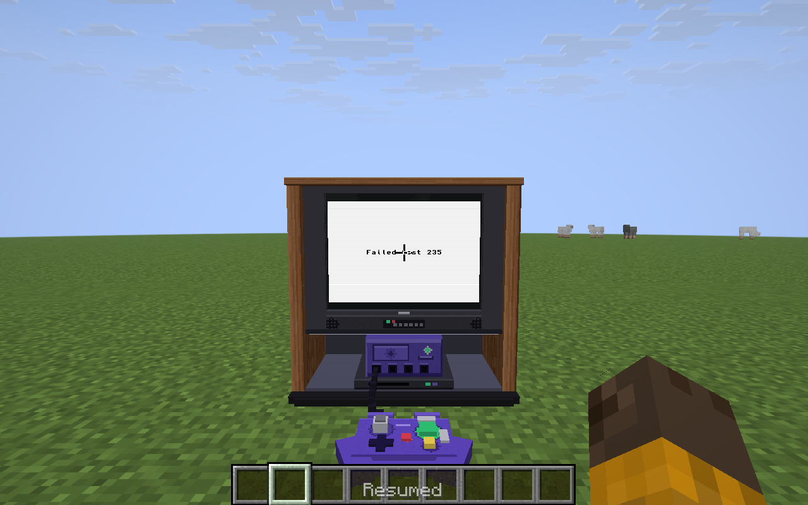

* **Craft it** (`I I I` / `C T C` / `A R A`: iron ingot, copper ingot, tinted glass, amethyst shard, redstone) or
  `/gba give crt`.
* **Place it.** Right-click the top (or side) of a block. The TV is **2 blocks wide, 2 high and 1 deep**: the clicked
  block is its left cell, the second cell is to the right, and it faces you. All four cells must be free. It is
  placed in the world as ordinary entities (no new blocks), so it survives restarts. **Punch it** (any game mode) to
  pick it back up as one CRT item, with the pak still inside. Placing consumes the item in survival.
* **Insert a game.** Hold a Game Pak in your off hand and **sneak + right-click** the TV; sneak + right-click with an
  empty off hand ejects it.
* **Play.** Right-click the TV (stand 3 to 6 blocks away). The camera turns to the screen and the game appears on the
  TV in the world; the world keeps rendering. **The crosshair, held item and the whole HUD (hotbar, health, XP, ...)
  are hidden while you play**, like F1, so you only see the TV plus a small hint line at the bottom; your previous
  setting (including F1 already being on) is restored exactly when you leave. Nothing is saved to `options.txt`.
  Controls are the same as on the GBA, plus two keys for saves:

  | CRT | Key |
  | --- | --- |
  | D-pad / A / B / L / R / Start / Select | Arrows / `X` / `Z` / `A` / `S` / `Enter` / `Backspace` |
  | Fast-forward (hold) | `Space` (or `Tab`) |
  | Save state / load state | `F5` / `F8` |
  | **Export the save** | `E` (to `gbalink/exports/`) |
  | **Import a save** | `I` (picker, then confirmation; the game keeps running behind it) |
  | Power off | `P` |
  | Options panel (save/load state, export/import, power switch, volume wheels, Unlink, Leave) | `O` or the **Options** button (top right) |
  | Volume: GBA / Minecraft | `-` `=` / `[` `]` |
  | Leave (suspends the game like closing the GBA; asks first while linked, see *Leaving a link*) | `Esc` |

  Saves, suspend states and link cables work the same. One player at a time per TV.
* **Watch.** Modded players within 48 blocks see the live picture on the TV and hear it (low quality, about 8 KB/s).
  The TV has one volume, the **GBA volume wheel of the player at the TV**, so the player and the audience hear the same
  level: full up to 4 blocks, quieter with distance, silent at `crt_audio_distance` (24 blocks), panned left and right,
  and also scaled by each listener's own Minecraft master volume. Only the nearest TV is heard, and the audience does
  not need to be among the 10 watchers to hear it. At most 10 players watch one TV (nearest first); others see
  "Viewer limit reached" on the screen. There is no input replay: spectators only see and hear.
* **Settings** (server, `config/gbalink.properties`, created on first start):

  ```properties
  crt_max_viewers=10
  crt_view_distance=48
  crt_audio_distance=24
  ```

* **Bandwidth.** The player uploads the picture at 30 fps plus the sound: a still or slowly changing picture is
  about 8 to 15 KB/s in total, a scrolling game roughly 25 to 40 KB/s, and a worst case (full-screen noise) about 300
  KB/s (the picture is capped at 285 KB/s and the server drops a streamer that exceeds ~1 MB/s). The server sends that
  stream once per viewer, so a TV with 10 viewers can cost the server 10 times the upload. Lower `crt_max_viewers` on
  small connections. Everything is relayed by the server; clients never connect to each other.
* Clients and servers must run the same mod version (protocol 4 since 0.4.0): an older client is told to update the mod.

## Link cable

Hold a Link Cable and **right-click another player** who is within **16 blocks** and also has the mod. (GBA games only for now: a
player with a Game Boy or Game Boy Color game open does not take part in the link yet, see [Supported systems](#supported-systems).)
Up to **4 players** can share one cable room; use the cable on each additional friend. Then everyone
**opens their GBA** (with a link-capable game, such as a trading or multiplayer menu) and the games find
each other, just like real GBAs. You are disconnected if you wander out of range, or with `/gba unlink`.

### Netplay: full speed over the internet (same game)

When every linked player's Game Pak was burned from the **same ROM file** (e.g. two copies of the same
Pokémon game), the link runs in **netplay** mode:

* Every player's computer runs **all** the linked consoles, wired together with zero delay, and only the
  **button presses** travel over the network (a few bytes per frame). The games never wait for the network,
  so they run at full speed even with 100+ ms ping.
* Your buttons take effect a few frames late while linked (the **input delay**, adapted automatically to your
  ping: about 3 frames ≈ 50 ms at 50 ms ping). Turn-based games like Pokémon don't notice.
* While connecting you see "Connecting link…" (each console's state is sent to the others once). Then the
  status line reads e.g. `Link: P1 of 2 · netplay · delay 3f · ping 48 ms`.
* The consoles are compared every second; if they ever drift apart they are repaired automatically.
* While linked: fast-forward, save/load state and Import .sav are disabled, and the cartridge clock (Pokémon
  Emerald has one) is a shared virtual clock. Only your own console's save goes to the server.
* Closing your GBA, breaking the cable, walking out of range or disconnecting ends the link; the others
  reconnect automatically and a lone player just keeps playing.

More detail: [`docs/netplay.md`](docs/netplay.md).

### Classic link (different games)

If the players have **different** ROMs (e.g. Ruby with Emerald), the status line says
`Link (different games — slow mode)`. Each link transfer then waits for a network round trip, so games
that link every frame slow down with ping (fine on a LAN, slow over the internet).

## Supported platforms

| OS | CPU | |
| --- | --- | --- |
| Windows 10+ | x64 | yes |
| macOS 11+ | Intel and Apple Silicon | yes |
| Linux (glibc 2.17+) | x64 | yes |

Linux ARM and Windows ARM are not supported. On an unsupported platform the mod still loads (and the
server side works); the GBA screen just says the emulator is unavailable.

## Building from source

You need Git, JDK 25, CMake 3.16+, a C compiler, Python 3, and [Zig](https://ziglang.org/) 0.17 (only to
build the Windows and Linux libraries).

```sh
git clone --recurse-submodules https://github.com/d-halverson/minecraft-gba-link.git
cd minecraft-gba-link

# 1. native emulator libraries -> dist/natives/<platform>/
#    (macOS builds both Intel and Apple Silicon; with zig installed it also builds Windows and Linux)
native/build_all.sh
# or just one platform:  native/build_target.sh macos-aarch64 --test

# 2. the mod (packs whatever is in dist/natives/ into the jar)
cd mod
./gradlew build
```

Results are in `mod/build/libs/`: `gbalink-<version>.jar` and `gbalink-resourcepack-<version>.zip`.
A jar only contains the natives you built, so build all four platforms for a release (the GitHub
Actions workflow in `.github/workflows/build.yml` does exactly this and attaches everything to a release
when you push a tag like `v0.3.0`). On Windows, build the natives with WSL or let CI do it. See
[`native/README.md`](native/README.md) for details and [`SPEC.md`](SPEC.md) for the design.

The tests (`./gradlew test`, `native/run_tests.sh`) use only small homebrew ROMs generated by
`native/tests/make_link_rom.py` and `native/tests/make_gb_rom.py` (Game Boy / Game Boy Color) and the MIT-licensed [jsmolka/gba-tests](https://github.com/jsmolka/gba-tests)
submodule.

## Known limitations

* **Netplay needs the same ROM** on every linked Game Pak; different games use the slower classic link.
  Netplay has a small input delay (2–10 frames, adaptive), and it has been tested with homebrew link
  ROMs and simulated ping, not yet with every commercial game. Please report games that desync.
* **Game Boy and Game Boy Color:** single player only for now (no link cable, no netplay; a Game Boy link is planned). DMG games use a
  fixed green palette (no choice of colours), Game Boy Color games get no colour correction, there are no Super Game Boy borders or
  colours, and no GB / GBC BIOS is used. mGBA does not allow Left+Right or Up+Down at once. CRT TV and spectators show the Game Boy picture
  letterboxed in the 240x160 canvas (centred 1:1, black bars) rather than scaled up.
* **No Wireless Adapter**, GBA Player, JOY bus or UART mode. Only the cable modes (Normal 8/32-bit and
  Multiplayer, 2 to 4 players) are emulated. Normal mode with 3 to 4 players is only approximate.
* **mGBA 0.10.5 accuracy:** very accurate for commercial games, but a few exotic hardware edge cases
  fail jsmolka's strictest tests (for example CMP with PC as destination, STM with the base register in
  the register list, unaligned halfword stores to SRAM). Games that depend on real BIOS timing may
  differ because the replacement (HLE) BIOS is used.
* Link state is not part of a save state; loading a state or resetting disconnects a transfer in flight.
* Everyone playing the same pak must have the identical ROM file.
* **CRT TV:** one player per TV, spectators must have the mod and be within the view distance; the cabinet's
  controller and console are decoration (they do nothing).
* Early version (0.4.0): expect rough edges. Please report bugs with your OS, game and what happened.

## Credits and license

* Emulation by **[mGBA](https://mgba.io/)** by Jeffrey Pfau and contributors (MPL-2.0), statically linked
  and unmodified. See [`THIRD_PARTY_NOTICES.md`](THIRD_PARTY_NOTICES.md).
* Test ROMs from [jsmolka/gba-tests](https://github.com/jsmolka/gba-tests) (MIT).
* Built with [Fabric](https://fabricmc.net/).
* GBA Link itself is [MIT licensed](LICENSE). "Game Boy Advance" is a trademark of Nintendo; Minecraft is
  a trademark of Mojang/Microsoft. This project is not affiliated with or endorsed by any of them.
